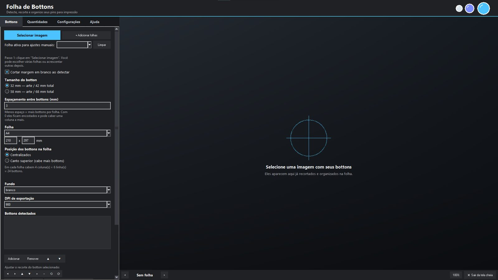
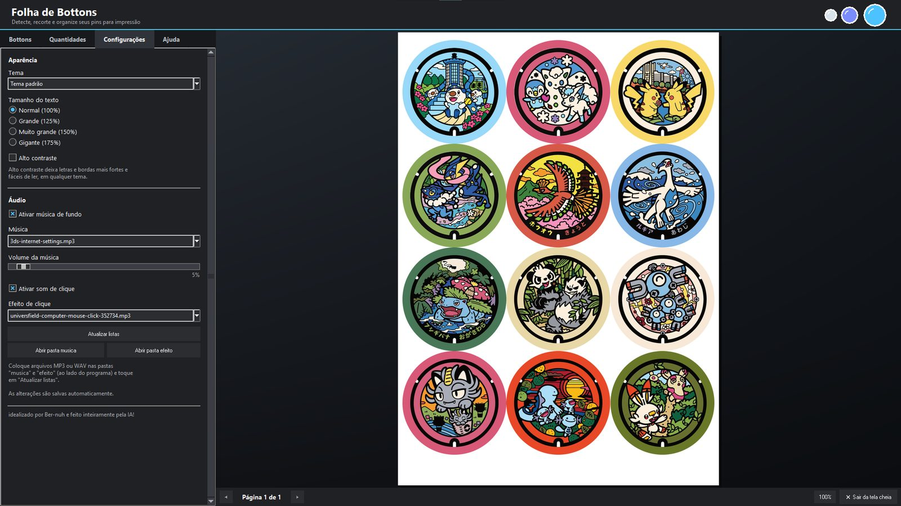
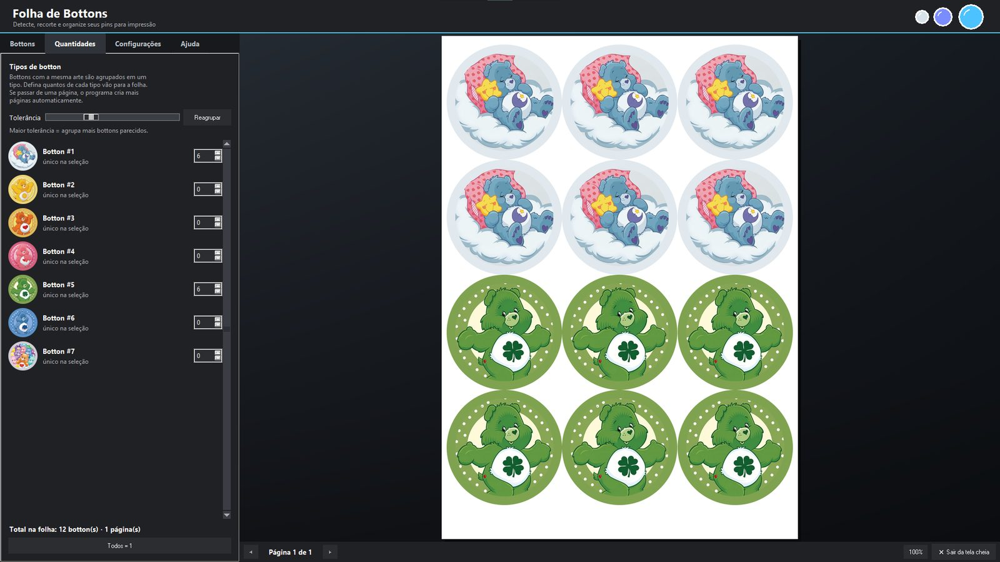
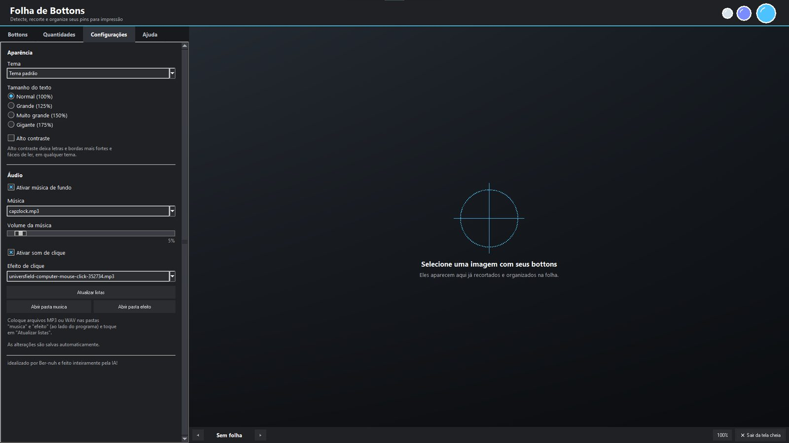
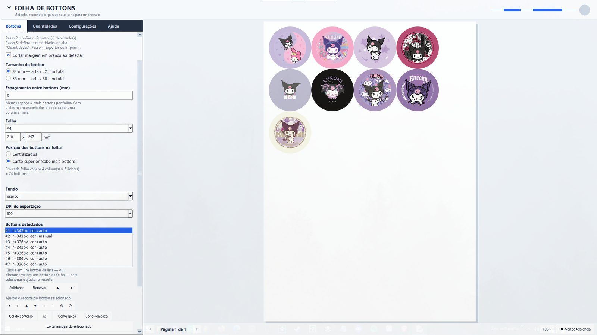
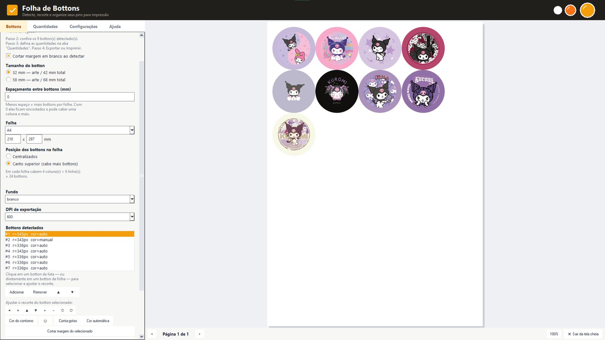
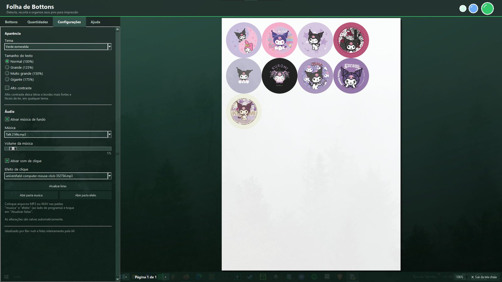
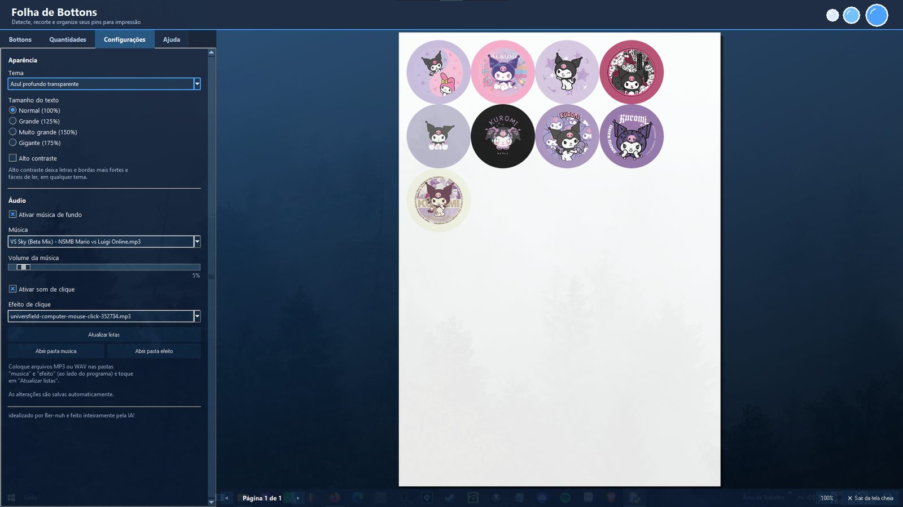
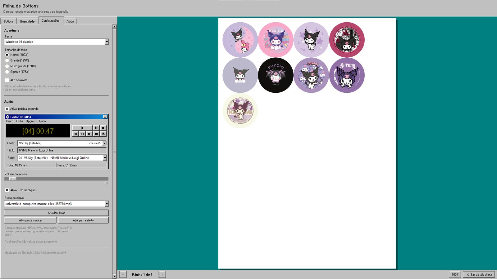
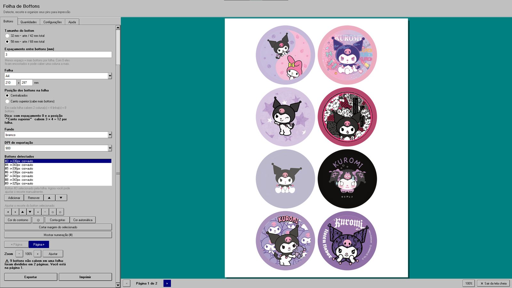

# Folha de Bottons

  <strong>Monte folhas de bottons para impressão de forma prática e organizada.</strong> 
  Aplicativo para Windows • Idealizado por <strong>Ber-nuh</strong>

  
  

> **Download:** clique em **BAIXAR PARA WINDOWS** para abrir a página oficial de versões. Escolha a versão mais recente e, na seção **Assets / Ativos**, clique no instalador `.exe`.

## ✨ Recursos

- Organização de imagens e montagem de folhas de bottons.
- Ajuste de dimensões e espaçamentos.
- Visualização da folha antes de imprimir ou exportar.
- Controle de quantidades por modelo.
- Temas visuais para personalizar a interface.
- Verificação de atualizações quando disponível e com conexão à internet.

## 📥 Como baixar e instalar

1. Clique no botão **BAIXAR PARA WINDOWS** no início desta página ou abra [a página oficial de versões](https://github.com/ber-nuh/Folha-de-Bottons/releases).
2. Na página da versão mais recente, localize **Assets / Ativos** e baixe o instalador com extensão `.exe` (confira o nome exibido nessa seção).
3. Quando o download terminar, abra o arquivo baixado.
4. Siga as etapas do assistente de instalação. Selecione a pasta de destino quando essa opção for apresentada.
5. Ao terminar, abra o **Folha de Bottons** pelo atalho criado pelo instalador, se disponível.

### Sobre o aviso “O Windows protegeu o computador”

O Windows pode exibir o aviso do Microsoft Defender SmartScreen e indicar **Editor desconhecido**. Isso pode acontecer com aplicativos independentes que ainda não têm reputação suficiente ou não possuem assinatura digital reconhecida.

Esse aviso, sozinho, não confirma que o arquivo contém vírus — mas também não é uma garantia de segurança. Para se proteger:

- Confira se baixou o instalador deste repositório oficial.
- Verifique se o nome do arquivo é **Instalador-Folha-de-Bottons.exe**.
- Se o Microsoft Defender indicar uma ameaça ou o arquivo parecer diferente do esperado, não prossiga; interrompa a instalação e peça ajuda.
- **Não desative o antivírus nem a proteção do Windows para instalar o programa.**

## 🧭 Abas do programa

### Bottons

A aba principal para selecionar imagens, detectar e organizar bottons, ajustar dimensões e espaçamentos, visualizar a folha e preparar a impressão ou exportação.

### Quantidades

Permite agrupar bottons por tipo e definir quantas unidades de cada modelo devem ser preparadas.

### Configurações

Reúne opções de aparência, tamanho do texto, alto contraste, áudio e verificação de atualizações.

## 🎨 Temas visuais

O aplicativo conta com seis temas visuais. As imagens abaixo são capturas do programa.

### 1. Tema padrão

### 2. Claro moderno

### 3. Âmbar premium

### 4. Verde esmeralda

### 5. Azul profundo transparente

### 6. Windows 95 clássico

## 🖨️ Impressão

Ao imprimir, selecione **100% / Tamanho real** para evitar que a escala da página altere as medidas dos bottons.

## 🔄 Atualizações e histórico de versões

- **Versão mais recente:** [abrir a página oficial de versões](https://github.com/ber-nuh/Folha-de-Bottons/releases).
- **Histórico de versões:** [ver todas as versões publicadas](https://github.com/ber-nuh/Folha-de-Bottons/releases).

Cada nova versão deve informar seu número (por exemplo, `v1.0.1`), as mudanças, correções e eventuais limitações. Baixe sempre o instalador anexado à versão publicada; não use executáveis enviados por fontes desconhecidas.

## 🧾 Sobre o projeto

Projeto idealizado por **Ber-nuh** e desenvolvido com auxílio de inteligência artificial.
